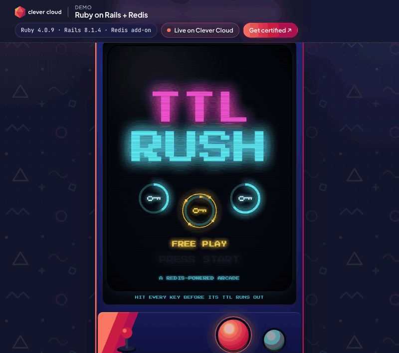
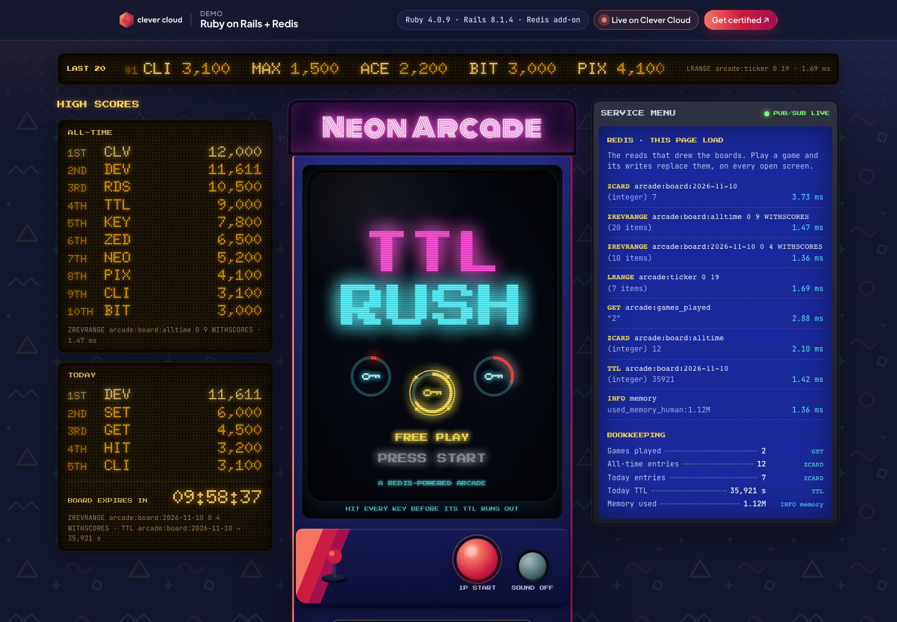

# Neon Arcade: Ruby on Rails + Redis on Clever Cloud

> A neon arcade cabinet you can play in 20 seconds, on a phone or a desktop. The game is **TTL RUSH**: keys pop up on a CRT screen with a TTL ring running down, and you hit them before they expire (an expired key replies `(nil)` and breaks your combo). Enter your initials the arcade way, and **Redis does everything the arcade needs**: sorted-set leaderboards, a game counter, a board that expires at midnight, a ticker list, and pub/sub that updates every open screen live. The operator's **service menu** shows the exact Redis commands the last game ran, with their latency. Rails 8.1 on Ruby 4.0, deployed on Clever Cloud, dressed in the Clever Brand Kit.





**Run it yourself.** The hosted demo was taken down after the presales review (November 2026). The steps in [Deploy on Clever Cloud](#deploy-on-clever-cloud) recreate it from scratch in about 10 minutes.

**Get certified.** This demo runs on Clever Cloud. To deploy your own apps the same way, get certified at the [Clever Cloud Academy](https://academy.clever.cloud/).

---

## What Redis does in the demo

Every surface of the arcade shows the Redis command that feeds it.

| Surface | Redis structure | Commands |
|---|---|---|
| Wall scoreboard, all-time | sorted set `arcade:board:alltime` (top 1000 kept) | `ZADD`, `ZREVRANGE … WITHSCORES`, `ZREVRANK`, `ZREMRANGEBYRANK` |
| Wall scoreboard, today | sorted set `arcade:board:YYYY-MM-DD`, expires at midnight (Paris) | `ZADD`, `EXPIREAT`, `TTL` (the countdown on the board) |
| Coin-door counter | counter `arcade:games_played` | `INCR`, `GET` |
| LED ticker | list `arcade:ticker`, the last 20 scores | `LPUSH`, `LTRIM`, `LRANGE` |
| Live board on every screen | Action Cable with the Redis adapter | `PUBLISH` / `SUBSCRIBE` on `neon_arcade:arcade` |
| Service menu | on page load, the reads that drew the boards; after a game (on any screen), that game's commands with replies and latency; bookkeeping from `ZCARD`, `TTL`, `INFO memory` (`used_memory_human` only) | |

A finished game runs, in order: `INCR`, `ZADD` ×2, `EXPIREAT`, `ZREVRANK` ×2, `LPUSH`, `LTRIM`, `ZREMRANGEBYRANK`, then `PUBLISH` through Action Cable. All of it lives in [`app/models/arcade.rb`](app/models/arcade.rb), written as raw commands with [redis-client](https://github.com/redis-rb/redis-client).

---

## Deploy on Clever Cloud

You need [clever-tools](https://www.clever.cloud/developers/doc/cli/) (`clever login` done) and the ID of the organisation that will own the resources (`orga_…`, shown in the Console). Run the commands from the repo root: `clever create` links the folder to the new app.

```bash
# 1. The app and its size
clever create --type ruby demo-ruby-redis --org <org_id> --region par
clever scale --min-flavor nano --max-flavor XS --min-instances 1 --max-instances 2
clever scale --build-flavor M

# 2. Redis (dedicated s_mono, encrypted at rest), linked to the app
clever addon create redis-addon demo-ruby-redis-redis --plan s_mono --region par --org <org_id> --option encryption=true
clever service link-addon demo-ruby-redis-redis

# 3. Variables (the secret is generated here and never printed)
clever env set SECRET_KEY_BASE "$(openssl rand -hex 64)" >/dev/null
clever env set CC_RUBY_VERSION 4.0
clever env set RAILS_ENV production
clever env set CC_RAKEGOALS assets:precompile
clever env set STATIC_FILES_PATH public
clever env set CC_HEALTH_CHECK_PATH /health

# 4. Deploy
clever deploy
clever open
```

No setup script: the default high-score tables are seeded at first start (see [Routes](#routes)). `GET /health/deep` checks that Redis answers.

### Variables

| Variable | Set by | Role |
|---|---|---|
| `REDIS_URL` | the Redis add-on (linked) | read by the app (`Arcade.redis`) and by Action Cable (`config/cable.yml`) |
| `SECRET_KEY_BASE` | you, once, never printed | Rails secret, generated with `openssl rand -hex 64` |
| `CC_RUBY_VERSION` | you | `4.0`: latest Ruby 4.0.x of the image ([Ruby runtime doc](https://www.clever.cloud/developers/doc/deploy/applications/ruby/)) |
| `RAILS_ENV` | you | `production` |
| `CC_RAKEGOALS` | you | `assets:precompile`: Propshaft fingerprints CSS, JS and SVG at build time |
| `STATIC_FILES_PATH` | you | `public`: NGINX serves the compiled assets, Rails serves the rest |
| `CC_HEALTH_CHECK_PATH` | you | `/health`: the deployment is validated without touching Redis |

The page also shows the platform variables `CC_APP_NAME`, `APP_ID`, `INSTANCE_NUMBER`, `INSTANCE_TYPE`, `CC_PRETTY_INSTANCE_NAME`, `CC_COMMIT_ID` (short) and `CC_DEPLOYMENT_ID` in the "Running on Clever Cloud" panel, and nothing else.

---

## Routes

| Route | What it does |
|---|---|
| `GET /` | the cabinet page (initial snapshot embedded) |
| `POST /scores` | one finished game: `{"score": {"initials": "ZED", "score": 14220, "hits": 31, "expired": 4, "combo": 18}}` |
| `GET /board` | JSON snapshot: boards, ticker, counters, read latencies (the page polls it if the WebSocket is down) |
| `GET /health` | 200, never touches Redis |
| `GET /health/deep` | `PING` through the pool, 503 if Redis does not answer |
| `/cable` | Action Cable WebSocket (`ArcadeChannel`) |

The default high-score tables are seeded at startup (`config.ru`, idempotent with `SET arcade:seeded … NX`), and today's board is refilled with house scores when a new day starts, like a real arcade machine. Scores are checked server-side (3 letters A-Z, plausible score for the number of hits).

---

## Local development

```bash
brew install ruby redis && brew services start redis
bundle install
bin/rails server                  # http://localhost:3000, REDIS_URL defaults to redis://localhost:6379/0
bin/rails test                    # 11 tests against a real Redis (database 15 is flushed)
```

Requires Ruby 4.0 and Rails 8.1.

---

## Project structure

```
app/models/arcade.rb            → every Redis command of the arcade, with a tracer for the service menu
app/controllers/                → arcade (page, /board), scores (POST), health (/health, /health/deep)
app/channels/arcade_channel.rb  → live board over Action Cable (Redis pub/sub)
app/views/arcade/show.html.erb  → the cabinet, the wall, the service menu, the Clever frame
app/javascript/arcade/game.js   → TTL RUSH: canvas game, attract mode, demo player
app/javascript/arcade/board.js  → renders Redis data on the LED boards, the counter and the service menu
app/javascript/arcade/sound.js  → 8-bit sound effects with Web Audio (muted by default)
app/assets/stylesheets/         → arcade.css (the universe), cc-brand.css (Clever Brand Kit, copied as-is)
config/cable.yml                → Action Cable on the Redis add-on
```

No database other than Redis (`rails new --minimal --skip-active-record`), no JavaScript build step (importmap), fonts from Google Fonts, every drawing is code (SVG and canvas).

MIT License.
